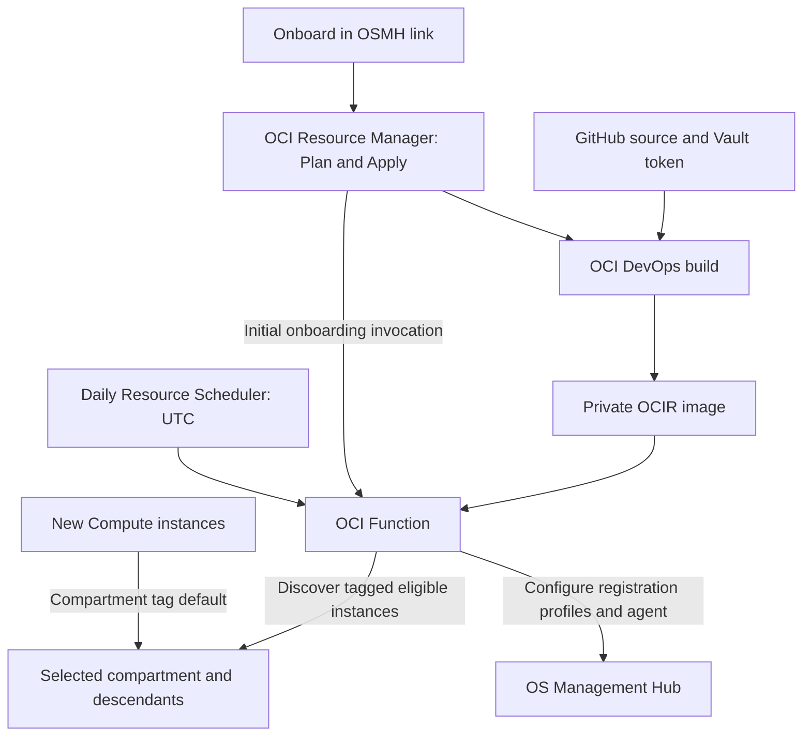

# Automate OS Management Hub Onboarding with OCI Resource Manager

## Introduction

Registering Compute instances with Oracle OS Management Hub (OSMH) is the first step toward centralized operating system management. **Onboard in OSMH** provides a guided OCI Console workflow to deploy the automation, select instances, and schedule daily registration checks—without running Terraform locally.

## Problem Statement and Use Case

As teams create instances across compartments, manual registration can leave systems outside central management. Repeating agent, registration profile, and access configuration also adds operational work.

This solution helps a platform team onboard existing eligible instances and automatically discover newly created instances in a selected compartment tree. It automates registration; patch installation and patch schedules are configured separately in OSMH.

## Prerequisites

Before opening the deployment link, prepare the following:

| Requirement | What you need |
| --- | --- |
| **OCI tenancy and region** | A commercial OCI tenancy with an active subscription to the deployment region, access to the required services, and available resource quotas. |
| **Permissions** | Access to create Resource Manager stacks and jobs, Functions, DevOps resources, OCIR repositories, schedules, Notifications, logging, networking, tags, and tag defaults. An administrator must also authorize dynamic groups and tenancy IAM policies. See the [deployment guide](RESOURCE_MANAGER.md#cloud-build-prerequisites) for build permissions. |
| **GitHub token in OCI Vault** | An active GitHub personal access token that can read this repository, stored as a Vault secret in the deployment region. Store the raw token as the secret value. Have its compartment available for selection; it can differ from the deployment compartment. |
| **Compute instances** | Running instances with an OSMH-supported operating system/image, a working Oracle Cloud Agent, and the OSMH Agent plugin available. Verify the [OSMH service prerequisites](https://docs.oracle.com/en-us/iaas/osmh/doc/getstarted.htm), including required network endpoints. |
| **Function networking** | Permission to create the supplied private VCN, subnet, and NAT gateway, or an existing regional subnet with outbound HTTPS and DNS connectivity. |

OCI DevOps builds and publishes the Function image using IAM. You do not need to supply an OCIR authentication token or build an image locally.

## Architecture

The initial run tags eligible instances chosen during deployment. Daily runs check tagged instances in the selected compartment tree and deployment region. Bulk discovery excludes stopped, identified OKE, unsupported, and already registered instances.

## Deploy in Five Steps

**[Onboard in OSMH](https://cloud.oracle.com/resourcemanager/stacks/create?zipUrl=https%3A%2F%2Fgithub.com%2Fgautamm2707%2FOSMH_ORM_TF%2Fraw%2Frefs%2Fheads%2Fmain%2Fresource-manager%2Fosmh-resource-manager.zip)**

1. **Open the stack wizard.** Sign in to OCI and switch the Console to your intended deployment region before using the link. On **Stack information**, choose a stack name and storage compartment. The link supplies the Terraform ZIP automatically.
2. **Choose the onboarding scope.** On **Configure variables**, select the same region and the **Deployment and onboarding compartment**. This compartment can differ from the stack's storage compartment. Select **Onboard all eligible instances** for the full compartment tree, or choose individual instances in the selected compartment.
3. **Configure the Function and schedule.** Create a Function application and network, or reuse an application by entering its OCID. For a new application using existing networking, select its VCN and regional subnet. Enable daily reconciliation and choose the start time in **UTC**.
4. **Select authentication and tags.** Under **Function build authentication**, choose the Vault secret's compartment and the GitHub token secret. Enter the tag namespace name; an active exact-name match is reused, otherwise a namespace with a unique suffix is created. Keep instance IAM creation enabled unless equivalent permissions already exist.
5. **Review and deploy.** Create the stack, run **Plan**, review the proposed resources and IAM policies, then run **Apply**. The stack builds the image, creates the Function and schedule, and starts the initial onboarding invocation.

The individual Compute picker lists one compartment and cannot filter eligibility. Use bulk onboarding for recursive discovery; runtime checks validate individual selections. An existing Function application must be active, use `GENERIC_X86`, and belong to the selected region and compartment.

## Verify and Onboard Future Instances

After Apply, open **OS Management Hub → Instances** in the deployment region and confirm registration. Check Function logs if instances are missing or pending. **Apply success confirms deployment and acceptance of the initial invocation; registration completes asynchronously.**

The stack creates or reuses a compartment tag default with the value `managedby=osmanagementhub` in the selected namespace. Future resources in that compartment and its descendants inherit the tag; the next scheduled run evaluates eligible tagged Compute instances. Tag defaults do not update existing resources, which is why initial bulk or individual selection is required.

If deployment fails, inspect the Resource Manager job and DevOps build logs, correct the reported issue, and retry **Apply in the same stack**. Detailed recovery steps are in the [deployment guide](RESOURCE_MANAGER.md#recovery-and-updates).

**Source and deployment package:** [OSMH_ORM_TF on GitHub](https://github.com/gautamm2707/OSMH_ORM_TF).
